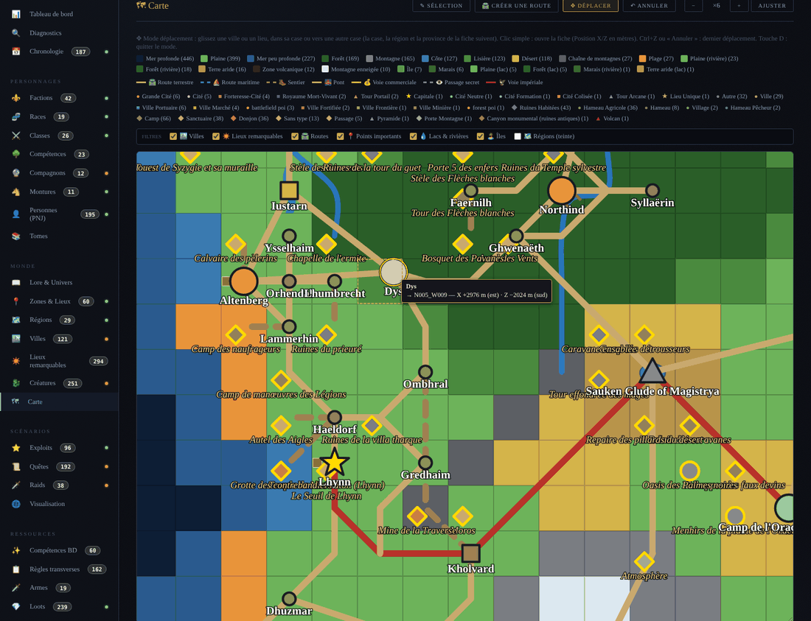
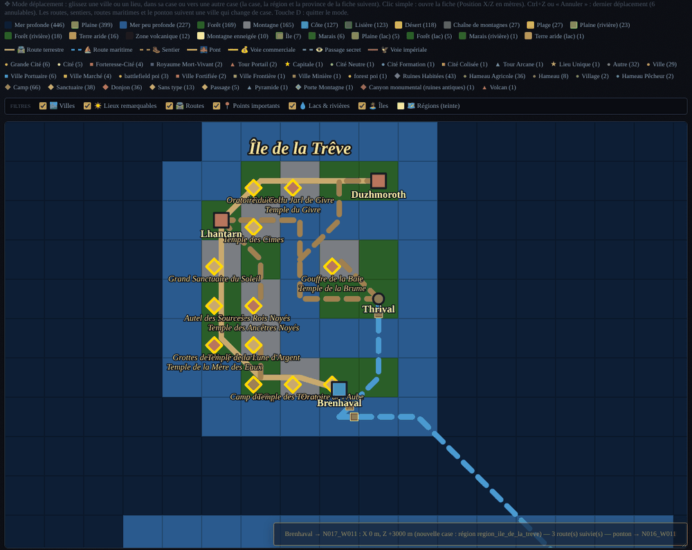
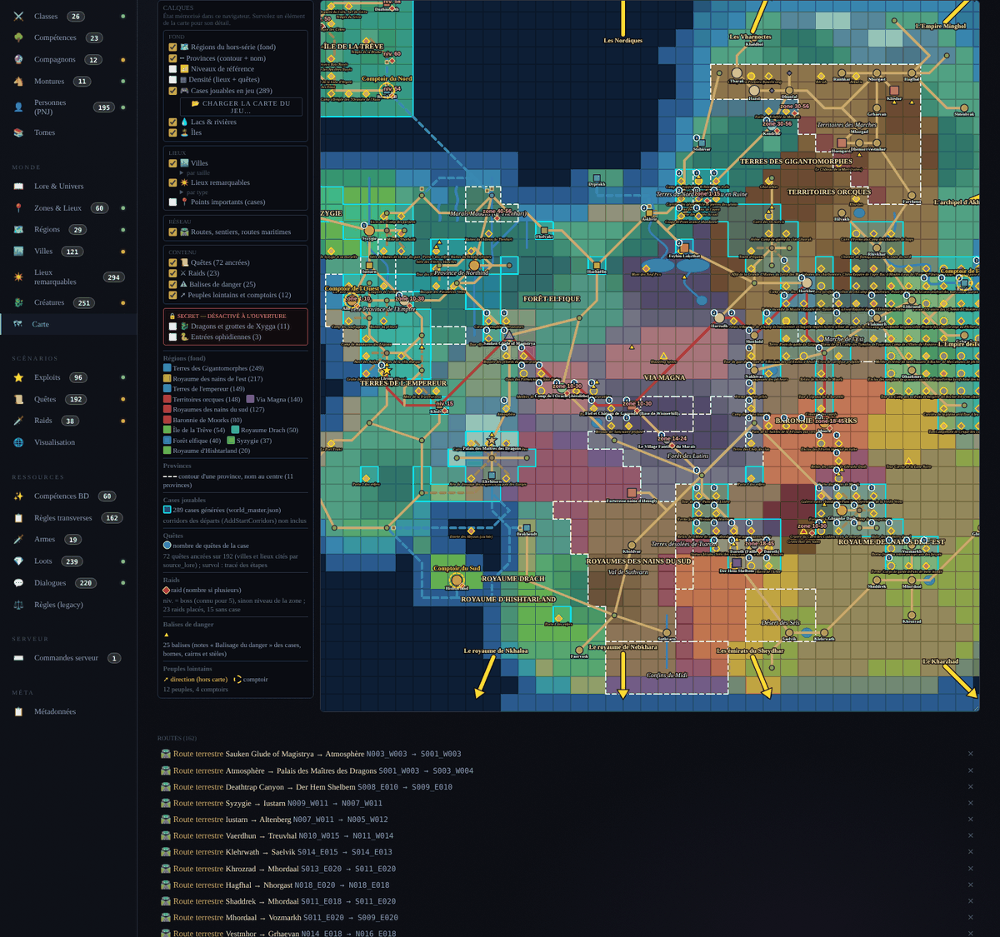
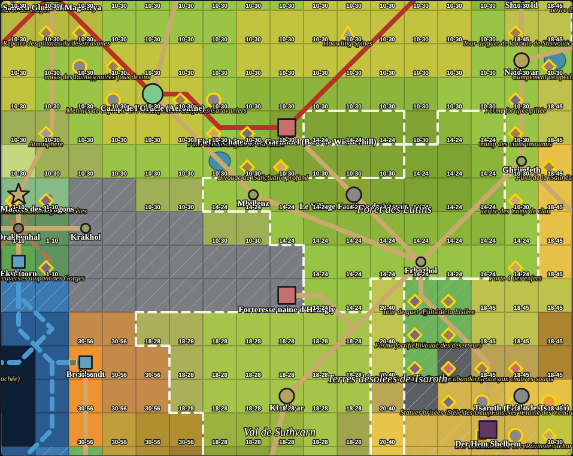
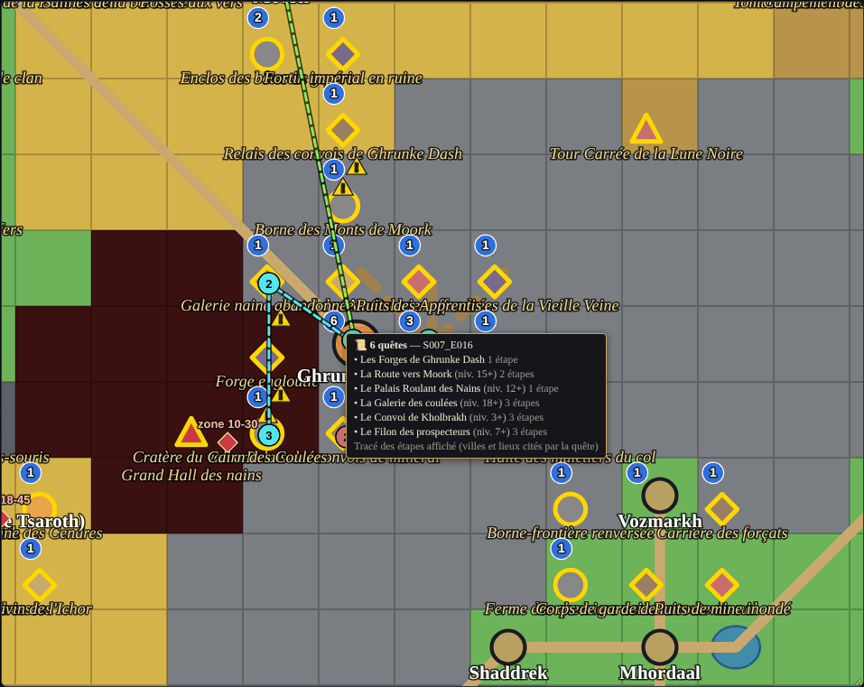
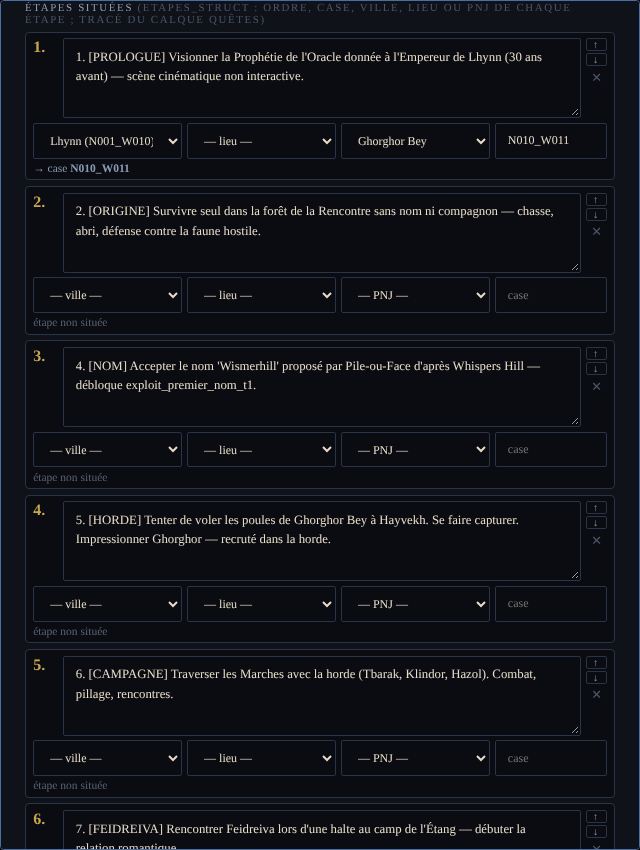
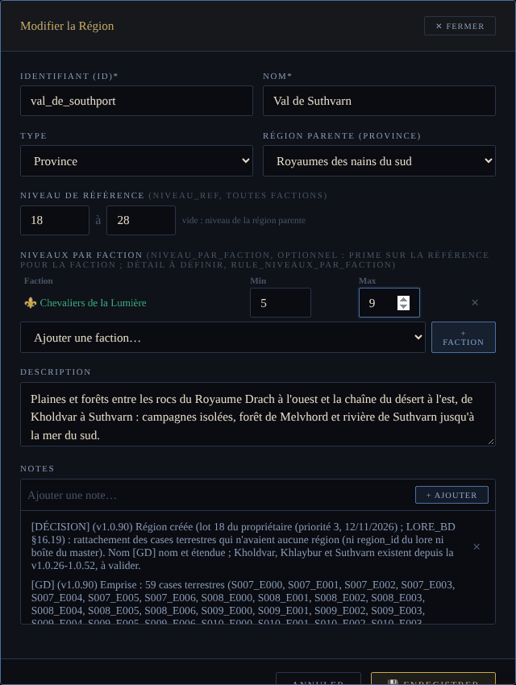

# Guide de l'éditeur de lore (`lune-noire-editor.html`)

> Pour qui : un mappeur ou un contributeur qui doit modifier le monde (villes, lieux, routes,
> régions, quêtes, raids, PNJ…) sans connaître l'historique du projet.
> État décrit : lore **v1.0.108** (branche `carte/corrections-v1.0.72`).
> Index de la documentation du monde : [`README.md`](README.md).

L'éditeur de lore est une **page HTML autonome** (aucun serveur, aucune installation) qui
ouvre le fichier de lore JSON, permet de le modifier par des formulaires et par une carte, puis
le réexporte **sans aucune perte**. Le lore est la **source** : le jeu ne lit pas ce fichier
directement, des scripts en recopient une partie dans le master du monde jouable
(voir [§9](#9-de-léditeur-au-jeu--le-flux-complet)).

Ce guide résume l'usage. Le détail de chaque évolution (motifs, chiffres, preuves) est dans
[`LORE_BD.md`](LORE_BD.md) §16.24 à §16.29 et §16.36 ; les scripts sont décrits dans
[`OUTILS_LORE.md`](OUTILS_LORE.md).

## Sommaire

1. [Fichiers](#1-fichiers)
2. [Ouvrir l'éditeur et charger le lore](#2-ouvrir-léditeur-et-charger-le-lore)
3. [Sauvegarder : export sans perte et remplacement des deux copies](#3-sauvegarder--export-sans-perte-et-remplacement-des-deux-copies)
4. [La carte : modes Sélection, Déplacer, Tracer](#4-la-carte--modes-sélection-déplacer-tracer)
5. [Le panneau des calques (dont calques secrets)](#5-le-panneau-des-calques-dont-calques-secrets)
6. [Les formulaires](#6-les-formulaires)
7. [Suppression et références](#7-suppression-et-références)
8. [Raccourcis clavier](#8-raccourcis-clavier)
9. [De l'éditeur au jeu : le flux complet](#9-de-léditeur-au-jeu--le-flux-complet)
10. [Les tests de l'éditeur](#10-les-tests-de-léditeur)
11. [Limites connues](#11-limites-connues)

## 1. Fichiers

| Fichier | Rôle |
|---|---|
| `legacy/world-builder-html/lune-noire-editor.html` | L'éditeur (HTML + JavaScript, ~875 Ko). |
| `legacy/world-builder-html/lune-noire-editor-v20.html` | Copie **identique** octet pour octet (à garder identique : `cmp`). |
| `legacy/world-builder-html/lune-noire-data.json` | Le lore (source de vérité du monde, ~11 Mo). |
| `legacy/world-builder-html/lune-noire-data-v20.json` | Copie **identique** octet pour octet du lore. |
| `legacy/world-builder-html/*-v18.*`, `*-v19.*` | Anciennes versions **historiques**, non maintenues : ne pas les modifier. |
| `game/data/world/royaumes/world_master.json` | Master du monde jouable (lu par `tools/world_gen`), alimenté par les scripts de [§9](#9-de-léditeur-au-jeu--le-flux-complet). |

Les deux copies (`.html` / `-v20.html`, `.json` / `-v20.json`) existent pour des raisons
historiques ; la CI vérifie que les deux JSON sont identiques (`validate_city_services.py`).

## 2. Ouvrir l'éditeur et charger le lore

1. Ouvrir `legacy/world-builder-html/lune-noire-editor.html` dans un navigateur récent
   (Chrome, Edge ou Firefox actuels : l'écriture exacte des nombres flottants en dépend).
   Double-clic sur le fichier : il fonctionne en `file://`, sans serveur.
2. Bouton **⬆ Importer JSON** (en haut) ou **⬆ Importer un fichier JSON** (écran d'accueil),
   choisir `legacy/world-builder-html/lune-noire-data.json`.
3. Naviguer par le panneau de gauche :

| Groupe | Sections |
|---|---|
| Vue d'ensemble | Tableau de bord, Diagnostics, Chronologie |
| Personnages | Factions, Races, Classes, Compétences (arbres), Compagnons, Montures, Personnes (PNJ), Tomes |
| Monde | Lore & Univers, Zones & Lieux, Régions, Villes, Lieux remarquables, Créatures, **Carte** |
| Scénarios | Exploits, Quêtes, Raids, Visualisation |
| Ressources | Compétences BD, Règles transverses, Armes, Loots, Dialogues, Règles (legacy) |
| Serveur | Commandes serveur |
| Méta | Métadonnées (`meta` : source, version, notes) |

Rien n'est enregistré automatiquement : **ni sauvegarde automatique, ni `localStorage` pour
les données**. Fermer l'onglet sans exporter perd les modifications. Seules des préférences
d'affichage (calques, liste des cases jouables) sont gardées dans le navigateur.

## 3. Sauvegarder : export sans perte et remplacement des deux copies

Une seule sortie : **⬇ Exporter JSON** (`exportJSON`). Le navigateur télécharge
`lune-noire-data.json`.

**Garanties** (v1.0.96 et v1.0.98, LORE_BD §16.25 et §16.27) :

- un export **sans modification** est **identique octet pour octet** au fichier chargé ;
- format exact du dépôt : `json.dumps(indent=2, ensure_ascii=False)` de Python (UTF-8,
  accents non échappés, flottants entiers écrits `1.0`, ordre des clés conservé,
  **sans retour à la ligne final**) ;
- **fusion à trois voies** à l'export (`mergeExportValue`) : seul ce que vous avez changé
  est écrit ; les champs que l'éditeur ne connaît pas, les types et l'ordre reviennent du
  fichier d'origine ;
- un formulaire ouvert puis **Enregistré sans rien changer ne modifie rien** (`formCapture` /
  `formMerge`) ; un champ vidé par l'utilisateur l'est vraiment ;
- aucun champ d'horodatage n'est ajouté.

**Remplacer les deux copies du dépôt** après l'export (le fichier téléchargé remplace
directement les deux) :

```powershell
# Windows (PowerShell), depuis la racine du dépôt
Copy-Item "$env:USERPROFILE\Downloads\lune-noire-data.json" legacy\world-builder-html\lune-noire-data.json
Copy-Item legacy\world-builder-html\lune-noire-data.json legacy\world-builder-html\lune-noire-data-v20.json
```

```bash
# Linux / macOS
cp ~/Downloads/lune-noire-data.json legacy/world-builder-html/lune-noire-data.json
cp legacy/world-builder-html/lune-noire-data.json legacy/world-builder-html/lune-noire-data-v20.json
cmp legacy/world-builder-html/lune-noire-data.json legacy/world-builder-html/lune-noire-data-v20.json
```

Puis suivre le flux de [§9](#9-de-léditeur-au-jeu--le-flux-complet) (scripts de recopie et
contrôles). Ne jamais reformater le JSON à la main ni avec un autre outil (indentation, ordre
des clés, `\n` final) : la CI comparerait des fichiers différents.

## 4. La carte : modes Sélection, Déplacer, Tracer

Section **🗺 Carte**. Une case = une cellule de 10 km du monde jouable (identifiant
`N003_W009` : rangée nord/sud, colonne est/ouest ; le nord est en haut). Zoom par **−** /
**+** / **Ajuster** ; ×4 ou plus est conseillé pour travailler. Les hameaux n'apparaissent
qu'à partir d'un certain zoom.

| Bouton | Touche | Rôle |
|---|---|---|
| ✎ Sélection | — | Mode par défaut : clic sur une case = éditeur de la cellule (terrain, rivière, ville, points importants, province). Clic sur une route de la liste = sélection (noir). |
| 🛣️ Créer une route | — | Ancien mode (deux clics, ligne droite entre deux cases). Gardé ; préférer **Tracer**. |
| ✥ Déplacer | **D** | Glisser-déposer des villes et des lieux (v1.0.95). |
| 〰 Tracer | **R** | Créer, modifier, brancher et supprimer des routes à la souris (v1.0.97). |
| ↶ Annuler (n) | **Ctrl+Z** | Annule la dernière action de la carte (pile **commune** à Déplacer et Tracer, 100 actions). |



### 4.1 Déplacer une ville ou un lieu (« tu places, le jeu suit »)

Unité commune du lore au générateur : **mètres depuis le centre de la case**, **X vers l'est,
Z vers le sud**, au plus **±4300 m** par axe (arrondi au mètre). Champs du lore :
`position_x_m` / `position_z_m` (`null` = position automatique choisie par le générateur ;
`0, 0` = exactement au centre).

1. **✥ Déplacer** (ou **D**) : le curseur devient une main.
2. Glisser la ville ou le lieu : dans sa case, ou vers une autre case (la case visée est
   encadrée, l'info-bulle donne la case et la position). Hors carte : refusé.
3. Vers **une autre case** : la fiche prend la nouvelle case (et `anchor_tile`), sa **région** et sa
   **province** ; les **routes, sentiers et routes maritimes** qui citent la ville la suivent
   (extrémité et premier / dernier waypoint, cases de raccord insérées, boucle coupée) ;
   le **ponton** de ses lignes maritimes et de son port passe sur la case navigable la plus proche.
   Le message donne le nombre de routes suivies.
4. Valeur exacte : clic simple sur le marqueur → formulaire, champs **Position X (m, est)** et
   **Position Z (m, sud)** (vides = automatique ; un seul champ rempli ou une valeur au-delà
   de ±4300 m est refusé).
5. **Ctrl+Z** annule ; l'annulation ne défait que ce que l'action a changé (une édition faite
   ensuite par un formulaire est gardée).

Refus côté scripts et générateur : une ville **ancrée sur un relief** (colline de Vaerdhun,
crevasse de Vharholdt) ne se déplace pas — sauf un **gouffre**, qui suit sa ville (Thurvhal,
v1.0.107). Dans une case à plusieurs lieux sans position, le marqueur commun déplace le
premier ; recommencer pour le suivant.

### 4.2 Tracer, modifier, brancher, supprimer une route



- **Créer** : **〰 Tracer** (ou **R**), choisir le type dans la barre (Route terrestre `road`,
  Sentier `path`, Route maritime `sea_route`), cliquer la ville ou le lieu de **départ**, les
  **cases du chemin** (les cases entre deux clics éloignés sont ajoutées : tracé continu en
  8-voisinage), puis la ville ou le lieu d'**arrivée**. **Entrée** ou double-clic finit sur la
  dernière case ; **Retour arrière** retire le dernier point ; **Échap** abandonne.
- **Modifier** : clic sur une route (noire, poignées blanches, extrémités carrées) ; glisser un
  point le déplace ; glisser un segment insère un point ; **Alt+clic** ou **clic droit** supprime
  un point (pas une extrémité). Une extrémité glissée sur une autre case reprend la ville ou le
  lieu de cette case (sinon : jonction). Le type se change dans la barre.
- **Embranchement** : **Maj+clic** sur une route existante : la nouvelle route part du point le
  plus proche (jonction au format du lore : `from_place` = case de la route hôte,
  `from_ville_id` / `from_lieu_id` vides). Un point de la route hôte déplacé emmène ses
  embranchements.
- **Supprimer** : **🗑 Supprimer la route** (ou ✕ de la liste), confirmation dans une boîte
  HTML ; les embranchements qui en partent sont signalés et gardés.

Format écrit : celui des routes existantes (`id` numérique suivant, `from_/to_place`,
`from_/to_ville_id`, `from_/to_lieu_id`, `description`, `notes`, `waypoints`). Depuis la
**v1.0.105**, le générateur du jeu **suit ces tracés** (voir [§9](#9-de-léditeur-au-jeu--le-flux-complet)) :
une route terrestre tracée ici devient une route en jeu après `sync_routes.py` et la
régénération ; une route maritime reste une donnée du lore (pas de ponton en jeu).

## 5. Le panneau des calques (dont calques secrets)

Colonne à gauche de la carte (v1.0.99, LORE_BD §16.28). Cases à cocher groupées, légende de
chaque calque actif, info-bulle au survol de chaque élément. L'état est mémorisé dans le
navigateur (`localStorage`, clé `lcdlln-editeur-carte-calques-v1`) : **préférence d'affichage,
jamais écrite dans le JSON exporté**.



| Groupe | Calque (clé) | Donnée lue |
|---|---|---|
| Fond | Régions du hors-série (`regions`) | `cells[].region_id` |
| Fond | Provinces (`provinces`) | `cells[].province` (contour pointillé) |
| Fond | Niveaux de référence (`niveaux`) + sélecteur **Faction** | `regions[].niveau_ref`, `niveau_par_faction`, départs des factions (1-10) |
| Fond | Densité (`densite`) | villes + lieux + quêtes ancrées par case |
| Fond | Cases jouables (`jouables`) | `generated_cells` du master, chargé par **📂 Charger la carte du jeu…** |
| Fond | Lacs & rivières, Îles | inchangés |
| Lieux | Villes (`villes`), sous-filtre **par taille** | `villes[].taille` |
| Lieux | Lieux remarquables (`lieux`), sous-filtre **par type** | `lieux[].type` |
| Lieux | Points importants (`poi`) | points des cellules |
| Réseau | Routes, sentiers, routes maritimes (`routes`) | `routes` |
| Contenu | Quêtes (`quetes`) : pastille ; survol = tracé numéroté des étapes | `etapes_struct`, sinon `source_lore` |
| Contenu | Raids (`raids`) | case du raid, `niveau_ref` |
| Contenu | Balises de danger (`balises`) | notes « Balisage du danger », lieux-balises |
| Contenu | Peuples lointains (`peuples`) | `factions[].territory.direction` et `.comptoir` |
| 🔒 Secret | Dragons et grottes de Xygga (`dragons`) | lieux `entree_cachee` d'une case de dragon boss |
| 🔒 Secret | Entrées ophidiennes (`ophidiens`) | lieux `entree_cachee` d'une case ophidienne |
| 🔒 Secret | Lieux et villes cachés (`caches`, v1.0.107) | fiches `secret: true` (Gouffre des Revenus, Fente, Thurvhal) |

**Calques secrets** : décochés **à chaque ouverture** de l'éditeur, jamais mémorisés actifs.
Sans eux, les grottes, entrées et lieux cachés ne sont dessinés par **aucun** autre calque
(ni Lieux, ni Villes, ni densité). À cocher seulement pour la conception, **jamais en partage
d'écran avec des joueurs**.

**Cases jouables** : bouton **📂 Charger la carte du jeu…** → choisir
`game/data/world/royaumes/world_master.json` (liste gardée dans le navigateur,
`lcdlln-editeur-cases-jouables-v1` ; recharger après chaque modification du master). Les
corridors des départs (`AddStartCorridors` du générateur) ne sont pas dans `generated_cells` :
ils ne sont pas montrés.

| Niveaux de référence | Tracé des étapes d'une quête |
|---|---|
|  |  |

## 6. Les formulaires

Chaque section a une liste de fiches (cartes) avec **✎** (modifier), **✕** (supprimer) et un
bouton de création. Règles communes (v1.0.98) : enregistrer n'écrit que ce qui a changé ;
renommer une fiche **ne change pas son identifiant** ; une valeur absente des listes
déroulantes est gardée ; un formulaire refuse une fiche sans nom.

| Formulaire | Points à connaître |
|---|---|
| **Régions / provinces** | `type` (`region_hs` = région de la carte p.4 du hors-série, `province`, `region`), `nom_hs`, `parent_region` (province). **Niveau de référence** min / max (vide = non renseigné ; fourchette incomplète, inversée ou hors 1-100 refusée). **Niveaux par faction** : choisir une faction, **+ Faction**, saisir min / max, ✕ pour retirer. |
| **Cellule** (clic sur une case, mode Sélection) | terrain, région, province, rivière, lac, montagne, ville, points importants, notes. |
| **Villes / Lieux remarquables** | case, type (dont `mine_poi`, `gouffre_poi`), faction, **Position X / Z**, port (`ponton_cell`, `vers_cell`). `secret` et `entree_cachee` n'ont pas de champ : ils sont gardés tels quels à l'enregistrement (à poser dans le JSON). Une ville créée n'a ni `taille` ni PNJ de service tant que `generate_city_services.py` n'est pas relancé. |
| **Quêtes** | texte des étapes (`steps`, gardé tel quel) et **Étapes situées** (`etapes_struct`) : une ligne = texte + ville / lieu / PNJ / case ; ↑ ↓ ✕, **+ Étape**, **⇣ Reprendre le texte des étapes** ; étape sans texte ou case inconnue refusée. |
| **Raids** | **Niveau conseillé** min / max (`niveau_ref`) ; le formulaire rappelle le boss qui cite le raid ; `location_ville_id` (ville ou lieu). |
| **PNJ (Personnes)** | faction, race, **Description** et **Personnalité** (champs distincts). |
| **Peuples (races)** | accès aux classes (`class_access`), notes de chaque affiliation. |
| **Factions** | bloc repliable **Fiche détaillée** : identité visuelle, dirigeants, structure militaire, politique, territoire avec **ville du territoire** (`territory.ville_id`, v1.0.109) et **comptoir** (peuples lointains), `game_design` en JSON (invalide refusé, vide = retiré) ; clés inconnues gardées. |
| **Autres** | classes, arbres de compétences (modale), compagnons, montures, créatures, exploits, armes, loots, dialogues, chronologie, règles, commandes serveur, types de lieux, lore, métadonnées. |

| Formulaire de quête (étapes situées) | Formulaire de région (niveaux) |
|---|---|
|  |  |

**Niveaux** : ils ne sont **lus par aucun code du jeu** ; ce sont des données de conception
(calque Niveaux, futurs spawners). Règles et valeurs : [`ROYAUMES.md`](ROYAUMES.md) §11.2.

## 7. Suppression et références

- Toute suppression passe par une **boîte de confirmation HTML** (21 collections et les règles).
  Elle affiche le **nombre de références** à l'identifiant ailleurs dans le fichier, par
  collection (valeurs chaîne égales à l'identifiant), ou « Aucune référence ». **Annuler** ne
  change rien.
- Les références **ne sont pas nettoyées** : supprimer une fiche citée crée des références
  orphelines. Les lister ensuite avec `python3 tools/lore/check_references.py`
  ([`OUTILS_LORE.md`](OUTILS_LORE.md)). Au v1.0.108 : **89 références orphelines** (36 identifiants),
  à trancher par le propriétaire.
- Une route supprimée garde ses embranchements (signalés).
- Ctrl+Z ne concerne que la carte (Déplacer, Tracer), pas les formulaires ni les suppressions.

## 8. Raccourcis clavier

| Contexte | Touche | Effet |
|---|---|---|
| Carte | **D** | entrer / sortir du mode Déplacer |
| Carte | **R** | entrer / sortir du mode Tracer |
| Carte | **Ctrl+Z** | annuler la dernière action (Déplacer / Tracer) |
| Tracé en cours | **Retour arrière** / Ctrl+Z | retirer le dernier point |
| Tracé en cours | **Échap** | abandonner le tracé |
| Tracé en cours | **Entrée** ou double-clic | finir sur la dernière case |
| Mode Tracer | **Maj+clic** sur une route | embranchement |
| Mode Tracer | **Alt+clic** ou clic droit sur un point | supprimer le point |

## 9. De l'éditeur au jeu : le flux complet

```
éditeur (lune-noire-editor.html)
   │  ⬇ Exporter JSON
   ▼
lune-noire-data.json  ==  lune-noire-data-v20.json      (lore, source ; deux copies identiques)
   │  generate_city_services.py   → services et PNJ de service des villes (dans le lore)
   │  sync_positions.py           → `position` des cities / pois du master
   │  sync_routes.py              → `lore_roads` du master
   ▼
game/data/world/royaumes/world_master.json             (master du monde jouable)
   │  CI : workflow « Lore — services des villes » (contrôles --check)
   │  CI : builds Windows / Linux → lcdlln_world_gen (génération du monde) + world_gen_tests
   ▼
game/data/zones/cell_*, world/royaumes/*  (non versionné)  → paquet client + bundle master/shard
```

Étapes, dans l'ordre :

1. **Modifier** dans l'éditeur, **exporter**, remplacer les **deux** copies du JSON ([§3](#3-sauvegarder--export-sans-perte-et-remplacement-des-deux-copies)).
2. **Services des villes** — à relancer **sans `--check`** si vous avez créé ou supprimé une
   ville, changé sa taille, ou ajouté / retiré une **route terrestre** d'une ville (l'écurie
   compte les sorties `road`) :
   `python3 tools/lore/generate_city_services.py`
3. **Recopie au master** (le lore est la source ; écritures chirurgicales, rien d'autre ne change) :
   - positions manuelles : `python3 tools/lore/sync_positions.py`
   - tracés des routes terrestres : `python3 tools/lore/sync_routes.py`
4. **Contrôles locaux** (ceux de la CI, plus les tests de l'éditeur si l'éditeur a changé) :

   ```bash
   python3 tools/lore/validate_city_services.py
   python3 tools/lore/generate_city_services.py --check
   python3 tools/lore/sync_positions.py --check
   python3 tools/lore/sync_routes.py --check
   python3 tools/lore/test_sync_routes.py
   python3 tools/lore/check_references.py          # rapport (non bloquant)
   ```

   Sans Python installé sur le poste : lancer les mêmes commandes dans un conteneur ponctuel,
   par exemple `docker run --rm -v "${PWD}:/w" -w /w python:3.12 python tools/lore/sync_routes.py`
   (Python standard, aucune dépendance).
5. **Ouvrir des cases au jeu** si besoin : une case n'est jouable que si elle est dans
   `generated_cells` de `world_master.json` (ou dans un corridor de départ) ; une route qui
   traverse une case fermée bute sur le **mur invisible**. Ajout à la main dans le master
   ([`ROYAUMES.md`](ROYAUMES.md) §4 et §11.7).
6. **Commit** (lore, les deux copies, master, éventuellement éditeur) et push : la CI lance le
   workflow `.github/workflows/lore-city-services.yml` (contrôles `--check`, ~10 s), puis les
   builds Windows et Linux **régénèrent le monde** (`lcdlln_world_gen`, `world_gen_tests`) avant
   l'empaquetage.
7. **Déploiement** : client, master et shard **en lock-step** avec le `game/data` généré par la CI
   du même commit (le shard lit `respawn_points.txt`, `spawners.json` des cellules, le master et
   le shard lisent `start_locations.json`). Voir [`ROYAUMES.md`](ROYAUMES.md) §0 et §4.

Ce que le générateur **ne lit pas** dans le lore : niveaux, quêtes, raids, PNJ nommés,
créatures, types de lieux (le `kind` du POI au master décrit la forme générée), routes
maritimes et pontons.

## 10. Les tests de l'éditeur

Tests Playwright (Chromium sans affichage), lancés **à la main** après toute modification de
l'éditeur (Playwright n'est pas dans la CI : navigateur de ~150 Mo). Aucun test n'écrit dans le
dépôt ; code de sortie 0 = tout passe.

```bash
pip install playwright && python3 -m playwright install chromium   # une fois

python3 tools/lore/test_editor_roundtrip.py     # ~3 s   aller-retour : export sans modification identique
python3 tools/lore/test_editor_routes.py        # ~10 s  mode Tracer, embranchement, Déplacer, Ctrl+Z
python3 tools/lore/test_editor_forms.py --rapide  # ~1,5 min (complet sans --rapide : ~4 min)
python3 tools/lore/test_editor_layers.py        # ~15 s  calques, secrets, mémorisation, performance
python3 tools/lore/test_editor_fiches.py        # ~20 s  niveaux, étapes situées, mines, formulaires, suppression
```

État au v1.0.109 : les 5 tests passent sur les deux copies. `test_editor_fiches.py` lit désormais
le nombre de mines et de quêtes ancrées dans les données (ses attentes étaient figées au v1.0.103 :
point 57 de [`CHANGELOG_CARTE_v1.0.72-v1.0.108.md`](CHANGELOG_CARTE_v1.0.72-v1.0.108.md), corrigé).

Chaque test accepte `--editeur <html>` et `--donnees <json>` pour vérifier **la seconde copie**
(`lune-noire-editor-v20.html` / `lune-noire-data-v20.json`) ; `test_editor_routes.py`,
`test_editor_layers.py` et `test_editor_fiches.py` acceptent `--captures <chemin sans extension>`
(PNG, et un GIF pour les routes). Détail de chaque test : [`OUTILS_LORE.md`](OUTILS_LORE.md) §2.

Les fonctions JavaScript ajoutées ou modifiées de l'éditeur sont documentées dans le fichier
(rôle, paramètres, effets de bord), règle de `CLAUDE.md`.

## 11. Limites connues

- Les **niveaux** (référence, par faction, raids) et les **étapes situées** ne sont lus par aucun code du jeu.
- Cases de raccord des routes en ligne droite, sans regarder le terrain : à retoucher en mode Tracer.
- Le mode Tracer n'édite pas `description` ni `notes` d'une route (formulaire de route).
- La carte des **Enfers** n'est pas dans la carte de l'éditeur (lieux `carte: enfers`).
- Références orphelines signalées à la suppression, jamais nettoyées.
- Fusion de deux fiches (`executeMerge`) et import d'un ancien JSON « BD » (`importV05`) non testés en détail.
- Étiquettes qui se chevauchent aux petits zooms (noms des peuples, des provinces).
